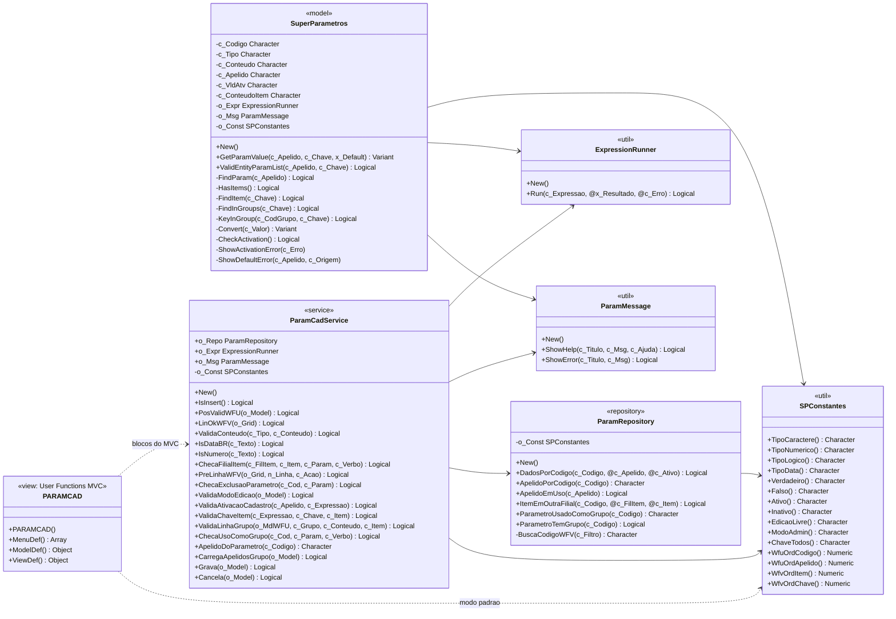
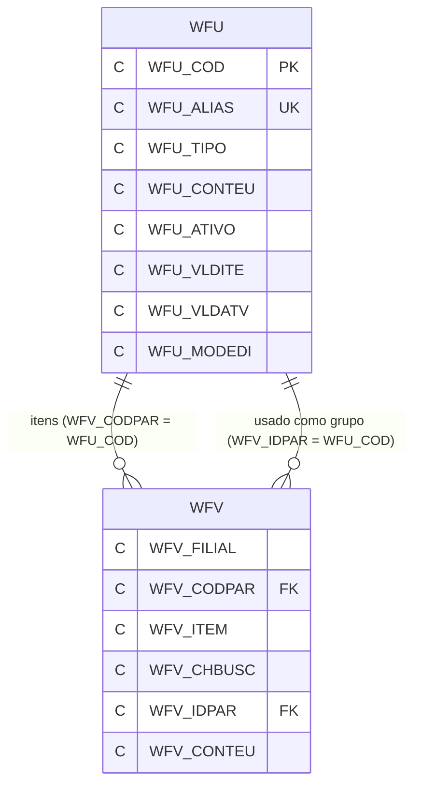

# Arquitetura e estrutura do banco

## 1. Organização dos fontes

Uma pasta por camada, uma classe por arquivo (arquivo = nome da classe) e o namespace acompanhando a pasta.

| Fonte | Namespace | Papel |
|---|---|---|
| `src/util/SPConstantes.tlpp` | `custom.superparametros.util` | Constantes compartilhadas: tipos, `V`/`F`, ativo/inativo, modos de edição, chave `*` e ordens de índice. |
| `src/view/PARAMCAD.tlpp` | `custom.superparametros.view` | Tela: `PARAMCAD` (browse), `MenuDef`, `ModelDef` e `ViewDef`. Só monta o MVC e liga os blocos ao serviço. |
| `src/service/ParamCadService.tlpp` | `custom.superparametros.service` | Regras do cadastro: validações, controle por filial, modo de edição, grupos, gravação e cancelamento. |
| `src/model/SuperParametros.tlpp` | `custom.superparametros.model` | Consulta usada pelos programas (`GetParamValue`, `ValidEntityParamList`). |
| `src/repository/ParamRepository.tlpp` | `custom.superparametros.repository` | Acesso a dados do cadastro: buscas na WFU e na WFV e as consultas SQL de uso como grupo. |
| `src/util/ExpressionRunner.tlpp` | `custom.superparametros.util` | Execução protegida das expressões (macro) com `try/catch`. |
| `src/util/ParamMessage.tlpp` | `custom.superparametros.util` | Exibição das mensagens (`Help`, ou log + alerta). |
| `test/TSTSP11.tlpp` | (global) | Funções de teste. **Só no ambiente de teste.** |

### Dependências entre camadas

```text
view ──► service ──► repository
  │         │            │
  └─────────┴────────────┴──► util ◄── model
```

| Camada | Pode usar | Não pode usar |
|---|---|---|
| `view` | `service`, `util` | Acesso direto a tabelas e regras de negócio |
| `service` | `repository`, `util` | Nada da tela (recebe o modelo MVC por parâmetro) |
| `model` | `util` | `view` e `service`: a consulta não depende da tela |
| `repository` | `util`, tabelas e SQL | Mensagens e regras |
| `util` | Nenhuma camada do projeto | |

**Exceção consciente:** a consulta (`SuperParametros`) ainda faz as próprias buscas na WFU e na WFV (`FindParam`, `FindItem`, `FindInGroups`, `KeyInGroup`), sem passar pelo `ParamRepository`. Essas buscas controlam o posicionamento das tabelas durante a procura nos grupos e foram testadas assim. Movê-las para o repositório fica como melhoria futura, com novo teste da consulta.

### Constantes de versão e título

Cada fonte com mensagem tem a sua constante, como pede o padrão de código:

| Fonte | Constante | Título das mensagens |
|---|---|---|
| `PARAMCAD.tlpp` | `PARAMCAD_VERSAO` | `PARAMCAD - v.DDMMAAAA` |
| `ParamCadService.tlpp` | `PARAMCADSERVICE_VERSAO` | `PARAMCADSERVICE - v.DDMMAAAA` |
| `SuperParametros.tlpp` | `SUPERPARAMETROS_VERSAO` | `SUPERPARAMETROS - v.DDMMAAAA` |

`ParamRepository`, `ExpressionRunner` e `ParamMessage` não têm mensagens próprias: o `ParamMessage` recebe o título de quem chama.

## 2. Diagrama de classes



### Responsabilidades

- **`PARAMCAD` (view):** monta o browse, o menu e o MVC (estrutura, gatilhos, `WHEN`, validações de campo) e liga cada bloco a um método do serviço.
- **`ParamCadService` (service):** tudo o que acontece na tela: validações do cabeçalho (`PosValidWFU`) e das linhas (`LinOkWFV`, `PreLinhaWFV`), controle por filial, modo de edição, grupos, gravação e cancelamento (com o número reservado pelo `GetSXENum`).
- **`ParamRepository` (repository):** buscas do cadastro na WFU e na WFV. Sempre guarda e devolve a área da tabela, para não tirar o MVC do registro.
- **`SuperParametros` (model):** consulta. Procura o parâmetro pelo apelido (`FindParam`, que também avalia o `WFU_VLDATV`), procura a chave (`FindItem`: exata, `*`, grupos) e converte o valor pelo tipo (`Convert`).
- **`ExpressionRunner` (util):** rotina única de execução das expressões, com `try/catch`.
- **`ParamMessage` (util):** forma única de mostrar as mensagens. Quem chama monta o texto e informa o título com a versão do próprio fonte.

## 3. Estrutura do banco

Os tamanhos sem número seguem o SX3 do ambiente. Os informados são os definidos no projeto. Em caso de diferença, vale o dicionário.

### 3.1 WFU: parâmetro (sempre compartilhada)

| Campo | Tipo/Tam. | Descrição |
|---|---|---|
| `WFU_FILIAL` | C | Filial (vazia, a tabela é compartilhada). |
| `WFU_COD` | C 6 | Código sequencial, gerado pelo `GetSXENum`. |
| `WFU_ALIAS` | C 50 | Apelido de identificação, usado na consulta. Obrigatório, sem espaços, único. |
| `WFU_DESCRI` | C | Descrição do que o parâmetro faz. |
| `WFU_TIPO` | C 1 | Tipo do conteúdo. Combo: `C=Caractere;N=Numérico;L=Lógico (V - Verdadeiro / F - Falso);D=Data`. |
| `WFU_CONTEU` | C | Conteúdo padrão, no formato do tipo. |
| `WFU_ATIVO` | C 1 | `1` = ativo, `0` = inativo. |
| `WFU_VLDITE` | C 250 | Expressão (macro) que valida a chave de busca do item. Lê a chave com `AllTrim(FwFldGet("WFV_CHBUSC"))`. Opcional. |
| `WFU_VLDATV` | C 250 | Expressão (macro) lógica de ativação. Opcional. |
| `WFU_MODEDI` | C 1 | Modo de edição. Combo `1=Edição Livre;0=Modo Admin`, inicializador `"1"`. |

`WFU_DBAPEL` (alias da entidade) foi removido.

### 3.2 WFV: itens (segue a regra da empresa)

| Campo | Tipo/Tam. | Descrição |
|---|---|---|
| `WFV_FILIAL` | C | Filial do item. |
| `WFV_CODPAR` | C 6 | Código do parâmetro (`WFU_COD`). |
| `WFV_ITEM` | C 3 | Número do item na lista. |
| `WFV_CHBUSC` | C | Chave de busca (ex.: código do usuário). `*` = todas as chaves. Não obrigatória no SX3: a regra "chave ou grupo" é validada no código. Antigo `WFV_CHENT`. |
| `WFV_IDPAR` | C 6 | Código do parâmetro usado como grupo. Consulta padrão (F3) na WFU. Opcional. |
| `WFV_DESGRP` | C 50 | Apelido do grupo. **Virtual** e só leitura, preenchido pelo código. |
| `WFV_CONTEU` | C | Conteúdo do item (exceção). Vazio = usa o `WFU_CONTEU`. Sempre vazio em linha de grupo. |

### 3.3 Índices (SIX)

| Tabela | Ordem | Chave | Uso |
|---|---|---|---|
| WFU | 1 | `WFU_FILIAL + WFU_COD` | Busca pelo código (cadastro e grupos). |
| WFU | 2 | `WFU_FILIAL + WFU_ALIAS` | Busca pelo apelido (consulta e unicidade). |
| WFV | 1 | `WFV_FILIAL + WFV_CODPAR + WFV_ITEM` | Relação do grid com o cabeçalho. |
| WFV | 2 | `WFV_FILIAL + WFV_CODPAR + WFV_CHBUSC` | Busca da chave. Com a chave vazia, encontra as linhas de grupo. |

### 3.4 Outros itens de dicionário

- **Consulta padrão (SXB)** da WFU para o F3 do `WFV_IDPAR`: mostra o código e o apelido e devolve o `WFU_COD`.
- **Administradores:** o modo de edição usa o `FWIsAdmin()`.

### 3.5 Relacionamento


